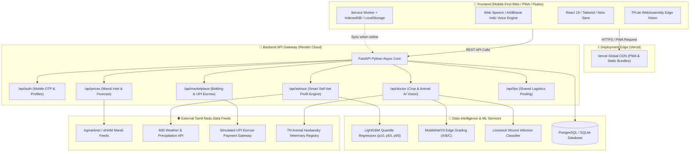

# System Architecture: Uzhavan Thunai (உழவன் துணை)

---

## Technical Architecture Stack Summary
1. **Frontend**: React 19, Vite, TailwindCSS (Deep Forest Green, Leaf Green, Harvest Gold, Soil Brown, Cream Paper), Lucide Icons, Canvas Confetti.
2. **Offline First**: Service Worker caching, optimistic UI updates, background synchronization.
3. **Multilingual i18n Engine**: 10 Indian Languages (Tamil, English, Hindi, Telugu, Kannada, Malayalam, Marathi, Bengali, Gujarati, Punjabi) with zero hardcoded strings.
4. **Backend Service**: High-performance Python FastAPI with Pydantic v2 schemas and SQLAlchemy 2.0 ORM.
5. **AI Inference Pipeline**:
   - Time-series price prediction with Quantile Regression (p10, p50, p90 confidence bounds).
   - Computer Vision MobileNetV3 edge quantization for produce freshness and livestock wound diagnosis.
